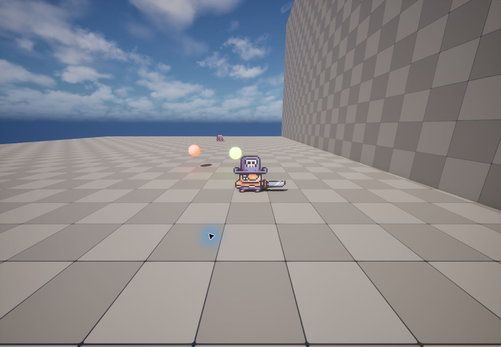

# ActionPlatformer

**2D 캐릭터의 검 공격과 능력 획득을 활용하는 액션 플랫폼 게임**입니다.

Unreal Engine 5.6과 Blueprint로 이동·점프, 근접 공격, 검 투척, 적 AI를 구현했습니다. PaperZD 애니메이션의 Notify와 전투 판정을 연결하고, 능력 아이템을 획득해 캐릭터의 행동을 확장하도록 구성했습니다.

## 스크린샷



*로컬 프로젝트 실행 화면*

## 프로젝트 개요

- **장르:** 액션 / 플랫폼 (2D 캐릭터)
- **엔진:** Unreal Engine 5.6
- **게임플레이 구현:** Blueprint
- **2D 표현:** Paper2D 스프라이트·플립북
- **애니메이션:** PaperZD
- **입력 처리:** Enhanced Input
- **적 AI:** AI Controller / Behavior Tree / Blackboard
- **플레이 테스트 맵:** `MAP_Debug`

## 플레이 방법

- **A / D 또는 ← / →:** 좌우 이동
- **Space Bar:** 점프
- **마우스 왼쪽 버튼:** 근접 공격
- **마우스 오른쪽 버튼:** 검 투척 능력 사용

능력 아이템을 획득하면 **더블 점프**와 **검 투척**을 사용할 수 있습니다. 입력은 `IMC_Action`과 `IA_Move`, `IA_Jump`, `IA_Attack`, `IA_Throw`로 구성되어 있습니다.

## 주요 구현 요소

### 공통 캐릭터 상태와 전투 처리

`BP_ActionChar`에서 플레이어와 적이 공유하는 체력·공격·피격 상태를 관리합니다.

- `MaxHealth` / `CurrentHealth`로 체력 관리
- `RecieveAttack`에서 공격 수신과 피해 처리
- 공격·스턴·패배 상태를 구분해 캐릭터 행동과 애니메이션에 전달
- 타이머로 스턴 지속 시간 관리와 상태 해제
- 스프라이트 흔들림으로 피격 피드백 표현

`BP_Captain`은 플레이어 입력과 능력 사용을, `BP_Shark`는 적의 감지와 공격 대상 처리를 담당합니다.

### 애니메이션 타이밍과 공격 판정 연결

PaperZD의 `ANS_Attack` Notify State를 이용해 공격 애니메이션 구간과 공격 상태를 연결했습니다.

- Notify 시작·종료 시점으로 공격 히트박스 활성 구간 구분
- `ABP_Captain`과 `ABP_Shark`에서 이동·피격·패배 상태 표현
- 플레이어의 공격·투척 애니메이션을 행동과 연결
- `ThrowSword` Notify에서 `SpawnSword`를 호출해 검 생성 시점 지정

### 능력 획득과 행동 확장

`BP_Ability_Pickup`이 캐릭터와의 겹침을 감지하고 `GainAbility`로 능력을 전달합니다.

- `E_Abilities`로 능력 종류 구분
- `UnlockedAbilities`로 획득한 능력 관리
- 더블 점프 획득 시 점프 횟수 확장
- 검 투척 획득 시 투척 행동 사용
- 공통 픽업 Blueprint를 더블 점프·검 투척 아이템이 공유

### 검 투척 액터

`BP_Sword`를 별도 액터로 구성해 캐릭터와 투사체의 역할을 분리했습니다.

- 캐릭터의 투척 위치에서 검 생성
- `ActiveSword`로 생성된 검 참조 관리
- 검의 겹침 이벤트와 피해 처리를 연결
- 회전 중인 검과 박힌 검을 별도 스프라이트로 표현

### Behavior Tree 기반 적 AI

`AIC_Enemy`가 `BT_Enemy`와 `BB_Emeny`를 사용해 적 행동을 제어합니다.

- `BP_Shark`의 겹침 영역으로 공격 대상 설정·해제
- Blackboard의 `AttackTarget`과 `IsStunned`로 판단에 필요한 상태 공유
- 스턴 여부와 공격 대상 유무에 따라 Behavior Tree 실행 흐름 제어
- `BTT_TryAttack`에서 캐릭터의 공격 상태를 확인하고 공격 실행
- `StunStateChanged` 이벤트 디스패처로 피격 상태 변화를 AI에 전달

## 실행 방법

**Unreal Engine 5.6과 해당 버전용 PaperZD 플러그인**이 필요합니다.

1. 저장소를 내려받습니다.

   ```bash
   git clone https://github.com/HRI-GD/ActionPlatformer.git
   ```

2. Unreal Engine 5.6에 PaperZD 플러그인이 설치되어 있는지 확인합니다.
3. `ActionPlatformer.uproject`를 Unreal Editor로 엽니다.
4. `Content/Maps/MAP_Debug`를 열고 **Play**를 누릅니다.
5. 게임 화면을 클릭해 입력 포커스를 준 뒤 캐릭터를 조작합니다.

캐시·로그·중간 빌드 결과와 사전 계산된 조명 데이터는 저장소에서 제외했습니다. 필요한 데이터는 에디터에서 다시 생성할 수 있습니다.

## 프로젝트 구조

```text
ActionPlatformer/
├── ActionPlatformer.uproject
├── Config/                           프로젝트·입력 설정
├── Content/
│   ├── Blueprints/
│   │   ├── Characters/
│   │   │   ├── BP_ActionChar         공통 체력·전투·피격 상태
│   │   │   ├── Captain/              플레이어와 애니메이션
│   │   │   └── Shark/                적과 애니메이션
│   │   ├── AI/                       컨트롤러·BT·Blackboard·Task
│   │   ├── Abilities/                능력 픽업과 표시 리소스
│   │   ├── NotifyState/ANS_Attack     공격 애니메이션 구간 처리
│   │   ├── Enums/E_Abilities          능력 종류
│   │   ├── BP_Sword                  투척 검 액터
│   │   └── GM_Action                 게임 모드
│   ├── Input/                        입력 액션과 키 매핑
│   ├── Maps/                         플레이 테스트 맵
│   ├── PaperAssets/                  2D 캐릭터·오브젝트 리소스
│   └── Sounds/                       효과음
└── docs/images/                      README 스크린샷
```

## 구현을 통해 다룬 내용

- 캐릭터 상속을 활용한 공통 전투·피격 처리
- 애니메이션 Notify와 실제 행동 시점의 연결
- Enum과 능력 목록을 이용한 행동 잠금·해제
- 별도 액터를 이용한 투사체 생성과 충돌 처리
- Behavior Tree와 Blackboard를 이용한 적 행동 구성
- 이벤트 디스패처를 통한 캐릭터·AI 상태 전달
